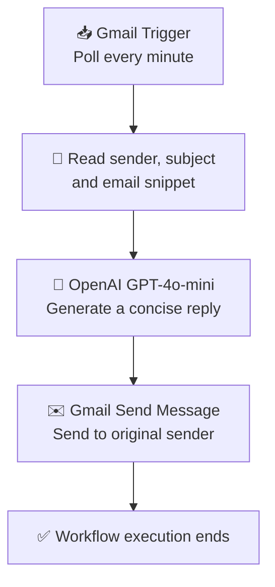

<div align="center">

# 📧 AI Email Auto-Responder
### Intelligent Email Reply Automation with n8n, Gmail & OpenAI

**Turn repetitive email replies into a faster, simpler workflow.**


</div>

---

## 📌 Overview

**AI Email Auto-Responder** is a low-code workflow built with **n8n** that monitors a Gmail inbox for unread incoming messages, asks OpenAI's **GPT-4o-mini** model to generate a concise and professional response, and sends that response through Gmail.

The project demonstrates how workflow automation and generative AI can be combined to reduce repetitive email work. It is designed as a learning project and can be extended with approval steps, email classification, sender filters, and richer message-context handling.

> **Important:** The included workflow currently sends a new email to the original sender using the original subject. It does **not** reply inside the original Gmail thread, and it does not currently filter automated senders. Review the workflow and test it with a separate account before activating it.

## ✨ Key Features

- **Automatic inbox monitoring:** Gmail Trigger polls every minute.
- **Unread-email filtering:** The trigger is configured to look for unread messages.
- **AI-generated replies:** GPT-4o-mini creates a short, professional response.
- **Dynamic email details:** The prompt includes the sender, subject, and Gmail snippet.
- **Automated sending:** Gmail sends the generated response to the sender address.
- **Visual, low-code workflow:** The nodes can be inspected and edited in n8n.
- **Extensible foundation:** Can be upgraded with human approval, filters, labels, logging, and thread-aware replies.

## 🔄 Workflow Architecture



### Node-by-node breakdown

| # | Node | Responsibility |
|---|---|---|
| 1 | **Gmail Trigger** | Checks for unread emails on a one-minute polling schedule. |
| 2 | **Message a model** | Sends the sender, subject, and email snippet to GPT-4o-mini to generate a reply. |
| 3 | **Send a message** | Sends the generated text to the original sender and reuses the original subject. |

## 🧠 AI Prompt

The workflow's system instruction asks the model to produce a helpful, professional reply under 100 words and to return only the email body (without a new subject line).

The user prompt is populated dynamically from the incoming Gmail item:

```text
From: {{ sender }}
Subject: {{ subject }}
Body: {{ email snippet }}
```

**Context limitation:** The current workflow uses Gmail's `snippet` field, which is only a short preview of the message. The model may not receive the full email body, attachments, or complete conversation history. For important messages, consider using a human-review step before sending.

## 🧰 Technology Stack

| Technology | Purpose |
|---|---|
| **n8n** | Visual workflow automation and orchestration |
| **Gmail Trigger / Gmail node** | Detect incoming unread messages and send responses |
| **OpenAI GPT-4o-mini** | Generate concise, natural-language email replies |
| **Google OAuth 2.0** | Authorize Gmail access from n8n |
| **JSON** | Store and transfer the workflow configuration |

## 📂 Project Structure

```text
n8n-AI_Email_Auto_Responder_Workflow-main/
├── AI Email Auto Responder.json   # Importable n8n workflow
└── README.md                      # Project documentation
```

## ⚙️ Requirements

Before setting up the workflow, make sure you have:

- An **n8n** instance (n8n Cloud or a self-hosted installation).
- A Gmail account you can use for testing.
- Permission to connect that Gmail account to n8n using Google OAuth.
- An OpenAI API account with API access and any required billing or usage limits configured.

## 🚀 Setup & Installation

### 1. Import the workflow

1. Open your n8n workspace.
2. Choose the option to import a workflow from a file (the exact menu wording can vary by n8n version).
3. Select **`AI Email Auto Responder.json`**.
4. Open the imported workflow and review each node before running it.

### 2. Configure Gmail credentials

1. Open the **Gmail Trigger** node and select or create Gmail OAuth credentials.
2. Complete Google's authorization flow.
3. Open the **Send a message** node and select the same authorized Gmail account, or another intended sending account.
4. Confirm that the account has the necessary Gmail permissions.

### 3. Configure OpenAI credentials

1. Open the **Message a model** node.
2. Select or create an OpenAI API credential in n8n.
3. Provide the API key through n8n's credential interface.
4. Confirm that the selected model is available to your account.

**Security note:** Never paste API keys, OAuth tokens, or passwords into this README, public repositories, screenshots, or workflow expressions. Store secrets in n8n credentials and remove any exposed credentials immediately.

### 4. Test before activation

1. Keep the workflow inactive while configuring it.
2. Use a separate test Gmail account to send a harmless test email to the connected inbox.
3. Run the workflow manually or use n8n's test-execution tools as supported by your version.
4. Inspect the input and output of every node.
5. Verify the recipient, subject, and generated response before allowing automated sends.
6. Check that the reply is appropriate and does not include sensitive or invented information.

### 5. Activate only when ready

The imported workflow is initially inactive. Activate it only after testing and after deciding that automatically sending replies is appropriate for the connected inbox. Start with a dedicated test inbox rather than a personal or business-critical account.

## 🛡️ Safety, Privacy & Reliability

Automated email sending can create unintended messages if the workflow is not carefully configured. Before using it with real email, consider these safeguards:

- **Human approval:** Generate a Gmail draft or send the proposed reply to yourself for review instead of sending immediately.
- **Sender exclusions:** Add conditions to skip `no-reply`, `noreply`, mailing lists, automated notifications, and your own address.
- **Loop prevention:** Track processed message IDs and avoid replying repeatedly to the same message.
- **Message validation:** Check that the sender address is valid and that the email is suitable for an automated response.
- **Sensitive content:** Do not automatically respond to messages containing confidential, financial, legal, medical, or other high-impact information without review.
- **Prompt-injection awareness:** Treat email content as untrusted input. Instructions inside an email should not override the assistant's intended role or workflow rules.
- **Data minimization:** Send only the message information needed to generate a response.
- **Execution monitoring:** Review n8n execution logs and configure error handling for failed API calls or delivery attempts.

## ⚠️ Current Limitations

The following points describe the **included JSON workflow**, not planned features:

1. **Snippet-only context:** The AI receives Gmail's snippet rather than the full email body.
2. **New email, not threaded reply:** The Gmail node is configured as **Send a message**, so the response may appear as a separate message instead of a reply in the original conversation.
3. **No automated-sender filter:** The current JSON has no conditional node to exclude `noreply` or notification senders.
4. **No human approval step:** Generated text is sent automatically once the workflow runs successfully.
5. **No explicit duplicate protection:** The workflow does not include a separate processed-message store or duplicate-send guard.
6. **No attachment or conversation-history handling:** Attachments and previous messages are not explicitly passed to the model.

## 🔮 Future Enhancements

- Add a **human approval** stage before sending replies.
- Fetch the full email body and sanitize HTML where needed.
- Use a Gmail reply operation with the correct message/thread identifiers to preserve conversation threading.
- Add sender exclusions, email-category filters, and spam/newsletter detection.
- Avoid duplicate replies by tracking Gmail message IDs.
- Create different reply styles for customer support, academic inquiries, job applications, and general messages.
- Add a knowledge base of approved FAQs and reference documents.
- Log each processed message, AI output, status, and error in a database or spreadsheet.
- Add retry logic and notifications for failed executions.
- Support multiple languages while retaining a professional tone.

## 🧪 Example Use Cases

- A learning demonstration of AI-powered workflow automation.
- Drafting short acknowledgements for routine inquiries.
- Prototyping an email assistant for a student project or small team.
- Exploring how APIs, language models, and event-driven workflows work together.

These are potential use cases, not guarantees that the current workflow is safe for every type of email.

## 🤝 Contributing

Ideas for improvement are welcome. Before submitting changes:

1. Test the updated workflow with a non-production Gmail account.
2. Do not commit credentials, API keys, personal email content, or OAuth tokens.
3. Update this README when the workflow's actual nodes or behavior change.
4. Document any new credentials or configuration requirements.

## 📜 License

No license is specified in the supplied project files. Add a license file before redistributing the project if you want to clearly define how others may use, modify, or share it.

## 👤 Author

**Anshu Pandey**  
**SRMU Lucknow**

---

<div align="center">

*Built as a practical project exploring AI-assisted email automation.*

</div>
